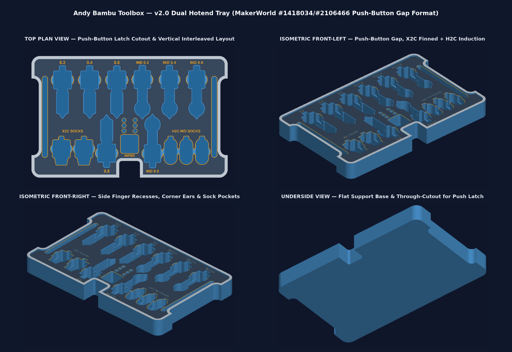

# Andy Bambu Toolbox — Dual Hotend Replacement Tray (`X2C` + `H2C Induction` | Push-Button Gap Format)

Custom upper replacement tray (Second Layer) compatible with the **Andy Bambu Lab Double-Layer Locking Toolbox** ecosystem ([MakerWorld #1418034](https://makerworld.com/en/models/1418034-bambu-lab-h2d-h2s-double-layer-locking-toolbox-har) and [MakerWorld #2106466](https://makerworld.com/en/models/2106466-h2c-tool-box-hotend-box)).

Designed with the **front-center push-button lock through-gap**, **4 corner ears with long left/right recessed finger-lift cutouts**, and **vertical interleaved dual-setup storage** holding both **X2C / H2D standard finned hotends** (left deck) and **H2C right-side cylindrical induction hotends** (right deck), complete with form-fitted silicone sock cavities, nozzle pin holes, and a central wiper pocket.

## Direct Downloads

- **Manifold 3D Print Mesh (`.STL`):** [`andy_dual_hotend_tray.stl`](andy_dual_hotend_tray.stl)
- **Parametric B-Rep Solid (`.STEP`):** [`andy_dual_hotend_tray.step`](andy_dual_hotend_tray.step)
- **Parametric Python CAD Source (`build123d`):** [`generate_tray.py`](generate_tray.py)

---

## Specifications & Tolerances (`v2.1`)

| Feature | Specification |
| :--- | :--- |
| **Outer Envelope ($X \times Y \times Z$)** | $184.20\text{ mm} \times 114.20\text{ mm} \times 18.50\text{ mm}$ ($-0.40\text{ mm}$ per-wall clearance inside $185 \times 115\text{ mm}$ box shell) |
| **Front-Center Push-Button Gap** | $19.50\text{ mm} \times 15.60\text{ mm}$ full-height U-shaped through-cutout at $-Y, X=0$ clearing the Bambu logo push-lock mechanism |
| **Side Finger-Lift Recesses** | $6.80\text{ mm}$ inward recessed side walls spanning $72.0\text{ mm}$ between the 4 corner ears + interior finger-access slots |
| **Left Deck (`X2C / H2D Standard`)** | 4x vertical interleaved contoured finned hotend slots (`0.2`, `0.4`, `0.6`, `0.8`) + 2x vertical `CAUTION HOT` finned silicone sock cavities |
| **Center Zone** | Front-center push-button latch gap + rectangular `WIPER` / purge spare pocket + 6x round nozzle needle/pin holes |
| **Right Deck (`H2C Induction`)** | 4x vertical interleaved H2C induction hotend slots (`IND 0.2`, `IND 0.4`, `IND 0.6`, `IND 0.8`) with bulbous $\varnothing 14.2\text{ mm}$ ($+0.50\text{ mm}$ coil relief) head + 3x molded induction sock capsules |
| **Retention Mechanism** | $0.15\text{ mm}$ interference snap beads on neck cradles to keep hotends seated when inverted |
| **Top Rim Clearance** | $1.50\text{ mm}$ recessed deck inside a $2.80\text{ mm}$ raised outer perimeter rim; all components sit $\ge 2.0\text{ mm}$ below top rim |
| **Size Indicators** | $0.40\text{ mm}$ debossed bold labels (`0.2`, `0.4`, `0.6`, `0.8`, `IND 0.2..0.8`, `X2C SOCKS`, `H2C IND SOCKS`, `WIPER`) |
