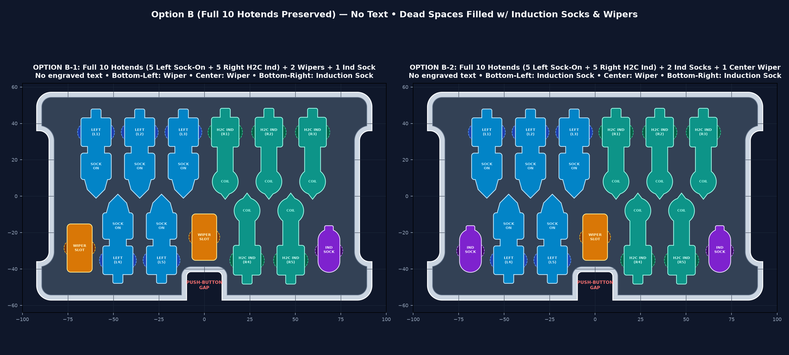

# Andy Bambu Toolbox — Dual Hotend Replacement Tray (`Option B-2`: 10 Hotends + 2 Induction Socks + 1 Center Wiper)

Custom upper replacement tray (Second Layer) compatible with the **Andy Bambu Lab Double-Layer Locking Toolbox** ecosystem ([MakerWorld #1418034](https://makerworld.com/en/models/1418034-bambu-lab-h2d-h2s-double-layer-locking-toolbox-har) and [MakerWorld #2106466](https://makerworld.com/en/models/2106466-h2c-tool-box-hotend-box)).

## Direct Downloads (`v3.0.0` — Option B-2)

- **Manifold 3D Print Mesh (`.STL`):** [`andy_dual_hotend_tray.stl`](andy_dual_hotend_tray.stl)
- **Parametric B-Rep Solid (`.STEP`):** [`andy_dual_hotend_tray.step`](andy_dual_hotend_tray.step)
- **Parametric Python CAD Source (`build123d`):** [`generate_tray.py`](generate_tray.py)

---

## Option B-2 Layout & Specifications

| Feature | Specification |
| :--- | :--- |
| **Outer Envelope ($X \times Y \times Z$)** | $184.20\text{ mm} \times 114.20\text{ mm} \times 18.50\text{ mm}$ ($-0.40\text{ mm}$ per-wall clearance inside $185 \times 115\text{ mm}$ box shell) |
| **Front-Center Push-Button Gap** | $19.50\text{ mm} \times 15.60\text{ mm}$ full-height U-shaped through-cutout at $-Y, X=0$ clearing the Bambu logo push-lock mechanism |
| **Side Finger-Lift Recesses** | $6.80\text{ mm}$ inward recessed outer side walls spanning $72.0\text{ mm}$ between the 4 corner ears |
| **Left Deck (`5x Left Hotends w/ Sock ON`)** | 5x vertical interleaved Left-Hand Finned Hotend slots (3 top pointing down + 2 bottom pointing up) contoured for the **`CAUTION HOT` silicone sock mounted ON the hotend** |
| **Right Deck (`5x Right H2C Induction Hotends`)** | 5x vertical interleaved Right-Hand `H2C` Induction Hotend slots (3 top pointing down + 2 bottom pointing up) with bulbous $\varnothing 14.20\text{ mm}$ ($+0.50\text{ mm}$ coil relief) head |
| **Bottom-Left & Bottom-Right Pockets** | **2x Induction Silicone Sock** pockets ($X = -68.5\text{ mm}$ and $X = +68.5\text{ mm}$) |
| **Center Pocket (above Push-Button Gap)** | **1x Wiper / Silicone Pad Slot** ($13.60 \times 25.50\text{ mm}$ at $X = 0.0\text{ mm}, Y = -22.5\text{ mm}$) |
| **Surface Finish** | Smooth recessed top deck ($Z = 17.00\text{ mm}$ inside $18.50\text{ mm}$ outer rim) with **zero engraved text** |
